

# OgAuto

**Telefon ekranını, telefon uygulamalarını ve IPTV / video yayınlarını Android Auto ekranına taşır.** 
Kablolu ve kablosuz Android Auto · root gerekmez · ücretsiz

 

&nbsp;&nbsp;

  

<table><tr><td align="center">
☕ <b>OgAuto tamamen ücretsiz ve reklamsız.</b> 
İşine yaradıysa <a href="https://www.patreon.com/c/onurguner"><b>Patreon’dan küçük bir destek</b></a> yeni özellikleri ve araç testlerini mümkün kılıyor. Teşekkürler!
</td></tr></table>

| Araçta | Ne yapar |
|---|---|
| **Yansıtma** | Telefon ekranını araçta yatay ve tam ekran gösterir; araç ekranından dokunma, kaydırma, hızlı kaydırma, iki parmakla yakınlaştırma, Geri / Ana ekran / Son uygulamalar. |
| **Uygulamalar** | Telefondaki uygulamaları araçta ızgara olarak listeler; seçtiğin uygulama telefonda açılır ve araçta görünür. |
| **Video / IPTV** | Yayını ekran yansıtması olmadan doğrudan araç ekranında oynatır (VYPN gibi uygulamalardan “harici oynatıcı”, paylaş veya M3U listesi). Yansıtmada video donması bu yolda yaşanmaz. |
| **VYPN** | Araç menüsündeki VYPN kutusu telefonda VYPN’i açar ve doğrudan yansıtmaya geçer. |
| **Tarayıcı / YouTube TV** | Araç ekranında web sayfası ve YouTube TV arayüzü. |

> Sürücü sürüş sırasında kullanmamalıdır. Netflix, Disney+, Prime Video gibi DRM korumalı servisler araçta görünmez; bu uygulama DRM korumasını aşmaz.

---

## Kurulum (sırayla)

Görseller adımları anlatan **temsili çizimlerdir**; menü adları telefon markasına ve Android sürümüne göre biraz farklı olabilir. Uygulamanın içinde de aynı adımlar numaralı liste olarak durur; her adımın düğmesi doğrudan ilgili ayar sayfasını açar ve tamamlanan adımlar ✓ olur.

### 1. APK’yı indir
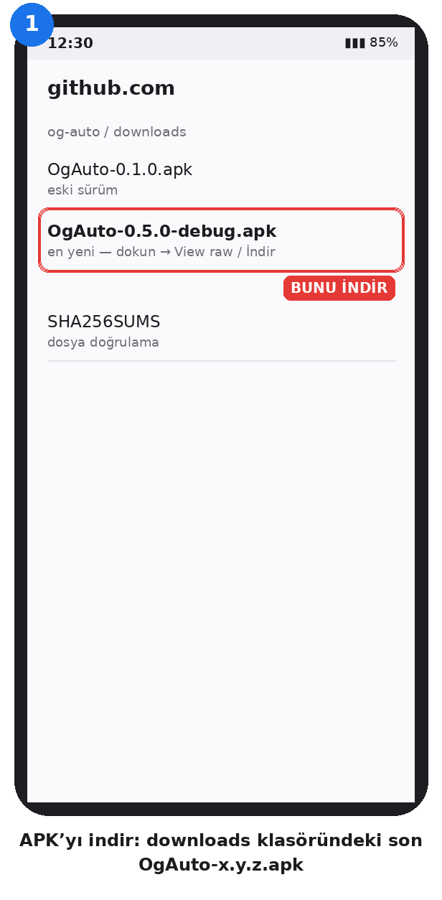

GitHub’da `downloads` klasörünü aç, en yeni `OgAuto-…apk` dosyasına dokun ve indir. Daha önce farklı imzalı bir OgAuto kuruluysa önce onu kaldır.

### 2. Play Protect taramasını kapat
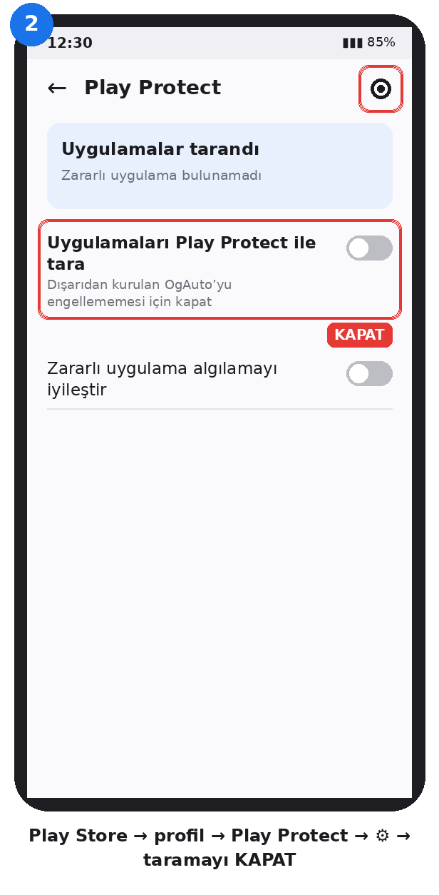

Play Store → sağ üstte profil resmi → **Play Protect** → sağ üstte ⚙ → **“Uygulamaları Play Protect ile tara”** kapalı. Play dışından gelen OgAuto’nun engellenmemesi veya silinmemesi için gerekli. Kurulum bitince tekrar açabilirsin.

### 3. APK’yı yükle
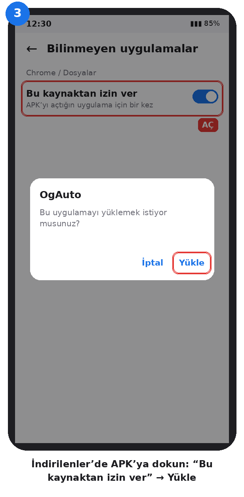

İndirilenler’de APK’ya dokun. İstenirse **“Bu kaynaktan izin ver”**i aç, geri dön ve **Yükle** de. “Güvenli olmayan uygulama” uyarısı çıkarsa **Ayrıntılar → Yine de yükle**.

### 4. OgAuto’yu aç ve onayla
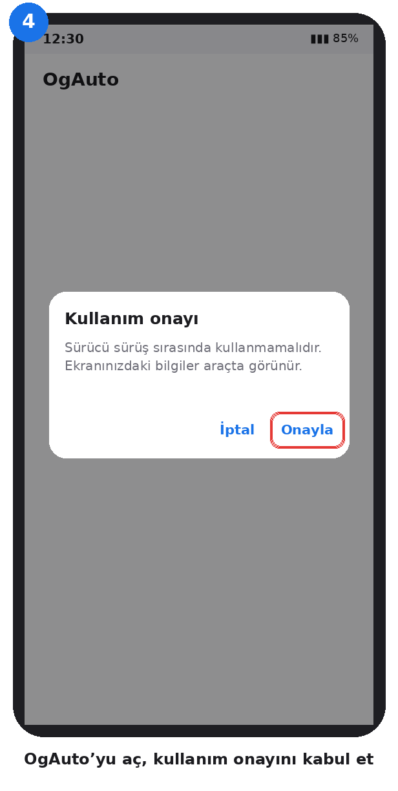

Kullanım onayını kabul et. Ana ekranda **“Kurulum adımları”** listesi görünür.

### 5. Uygulamadaki adımları sırayla tamamla
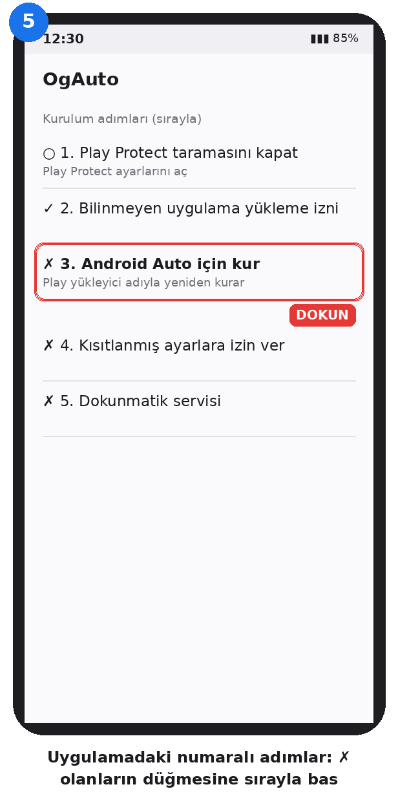

✗ işaretli her adımın altındaki düğmeye bas, ayarı yap, geri dön. Liste kendini günceller.

### 6. Android Auto için kur (Play yükleyici)
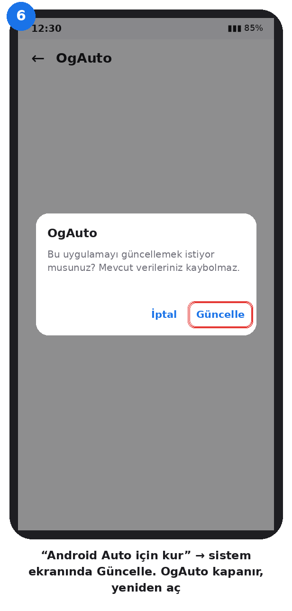

**“Android Auto için kur”** düğmesi OgAuto’yu, kurulum kaynağı Play Store olarak kaydedilecek şekilde yeniden kurar (KingInstaller’ın yaptığı işlem). Sistem ekranında **Güncelle** de. OgAuto kapanır; yeniden aç. Satırda ✓ görünmüyorsa telefon bu yöntemi kabul etmiyordur; 12–14. adımlar yine de OgAuto’yu Android Auto’da gösterir.

### 7. Kısıtlanmış ayarlara izin ver (Android 13 ve sonrası)
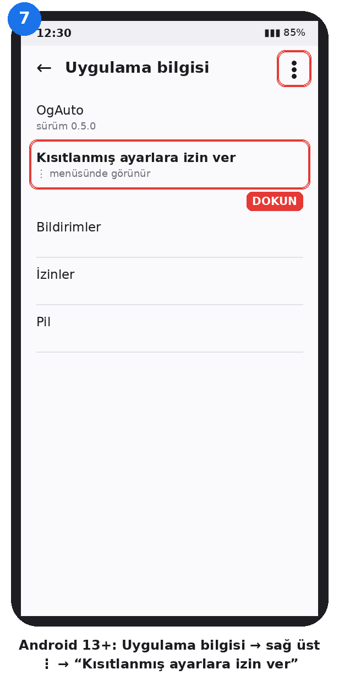

**Uygulama bilgisini aç** → sağ üst **⋮** → **“Kısıtlanmış ayarlara izin ver”** → kilit/parmak izi ile onayla. Menü görünmüyorsa önce 8. adımı bir kez dene (sistem engeller), sonra buraya dön; seçenek artık görünür.

### 8. Dokunmatik servisini aç
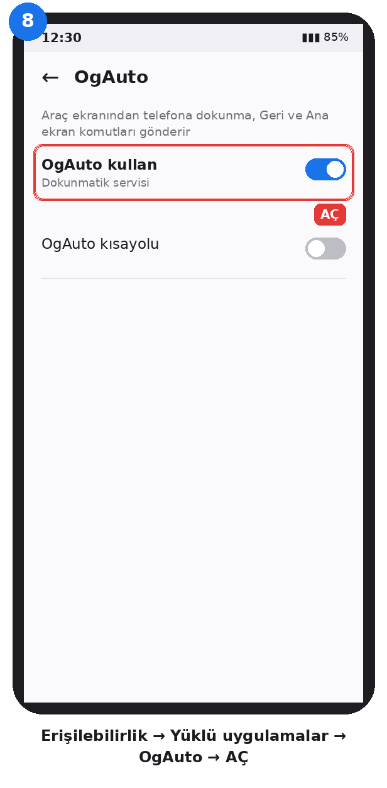

Erişilebilirlik → Yüklü uygulamalar → **OgAuto** → **Aç**. Araç ekranından telefona dokunma ve kaydırma bununla çalışır.

### 9. Diğer uygulamaların üzerinde göster
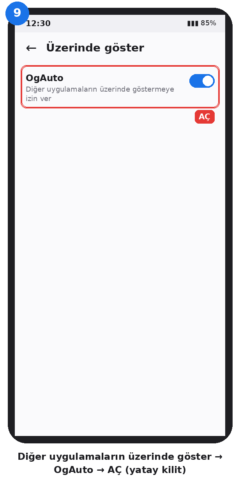

OgAuto için **aç**. Paylaşım boyunca telefonu yatay kilitler ve ekranı açık tutar.

### 10. Sistem ayarlarını değiştirme
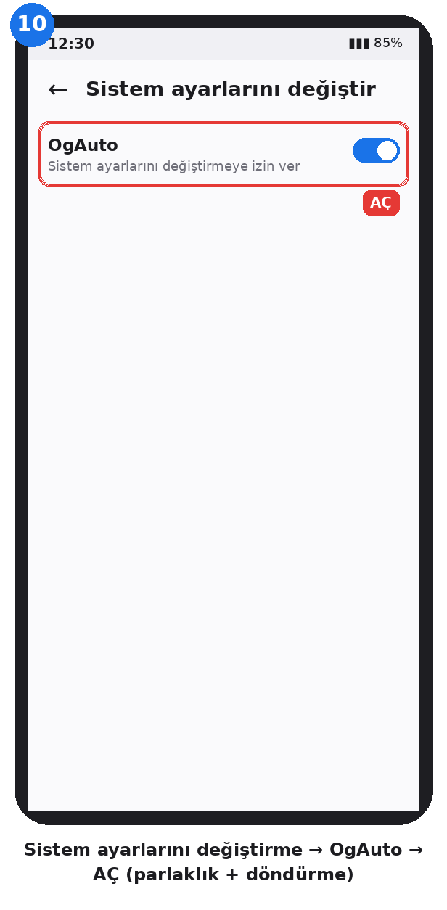

OgAuto için **aç**. Paylaşımda parlaklığı düşürür ve otomatik döndürmeyi yataya sabitler; paylaşım bitince eski ayarlar geri gelir.

### 11. Pil kısıtlamasını kaldır
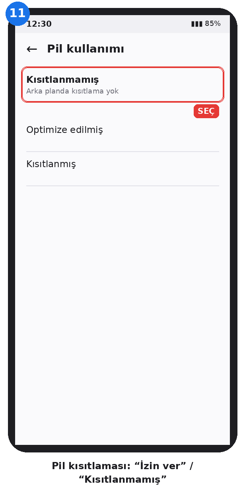

**İzin ver / Kısıtlanmamış** seç. Telefon OgAuto’yu arka planda durdurursa yansıtma kopar. Bildirim iznini de ver.

### 12. Android Auto geliştirici modunu aç
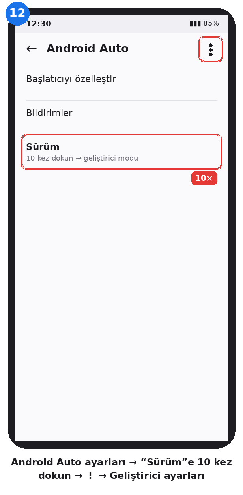

Uygulamadaki **“Android Auto ayarlarını aç”** düğmesi → en alttaki **Sürüm**e 10 kez dokun → onayla. Sonra sağ üst **⋮ → Geliştirici ayarları**.

### 13. Bilinmeyen kaynakları aç
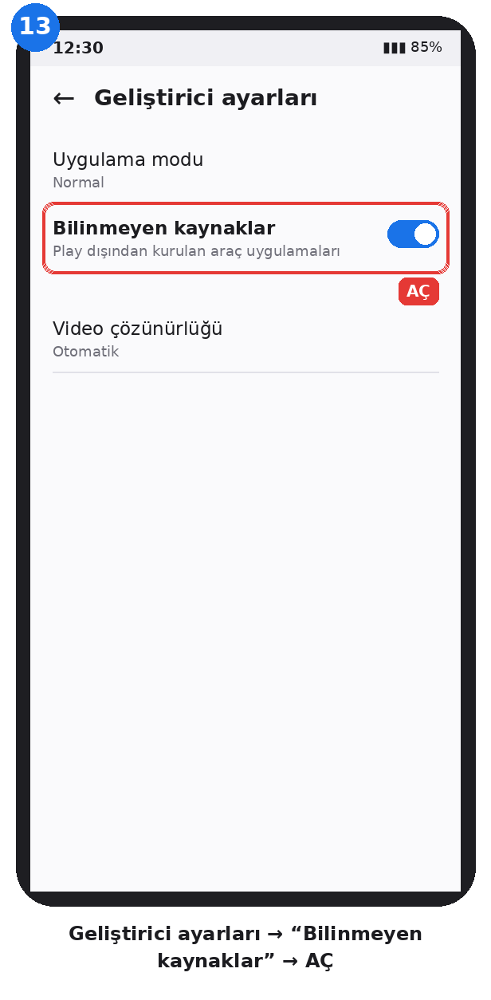

Geliştirici ayarlarında **“Bilinmeyen kaynaklar”** açık.

### 14. Başlatıcıda OgAuto’yu işaretle
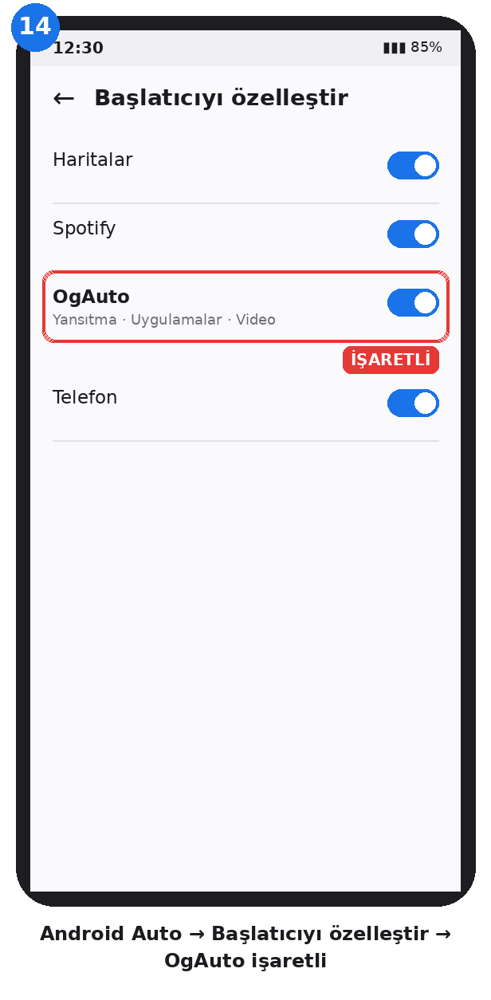

Android Auto → **Başlatıcıyı özelleştir** → **OgAuto** işaretli. Araca bağlandığında uygulama listesinde görünür.

### 15. Paylaşımı başlat — “Tüm ekran”
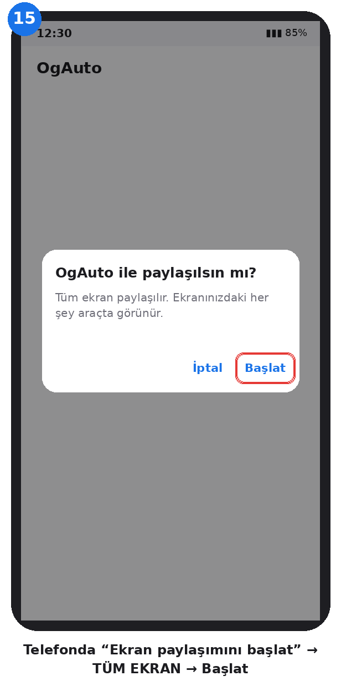

OgAuto’da **“Ekran paylaşımını başlat”** → sistem penceresinde **Başlat**. OgAuto her zaman tüm ekranı ister; “tek uygulama” seçeneği yayınların araçta son karede donmasına yol açıyordu.

### 16. Araçta kullan
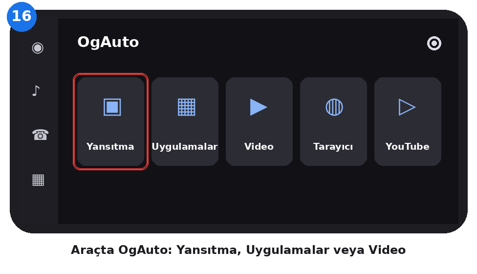

Araçta **OgAuto → Yansıtma**, **Uygulamalar** veya **Video**. Yansıtmada görüntü takılırsa ↻ düğmesine bas. Ayarlar’da yatay kilit, ekranı doldur ve video çözücü seçenekleri var.

### 17. IPTV / VYPN yayınlarını araçta oynat
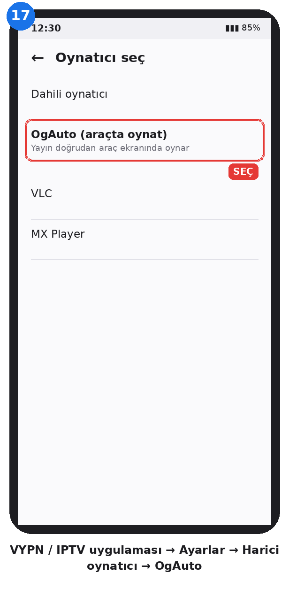

IPTV uygulamasının ayarlarında **Harici oynatıcı → OgAuto (araçta oynat)** seç; kanala bastığında yayın doğrudan araçta açılır. Bu seçenek yoksa yayın bağlantısını OgAuto ile **paylaş** ya da OgAuto’daki **M3U liste adresi** alanına listeni ekle. Araç donarsa araç Ayarlar’ında **Video çözücü → Yazılım** seç.

---

## Sorun giderme

- **Araç listesinde OgAuto yok:** 6, 12, 13, 14. adımlar; telefonu araçtan ayırıp yeniden bağla.
- **Dokunmatik çalışmıyor:** 7 ve 8. adımlar; Android bazen güncellemeden sonra erişilebilirliği kapatır.
- **Yansıtmada video donuyor:** Yayını 17. adımdaki Video modunda aç. Yansıtmada kalacaksan araçta ↻ ve video çözücüyü değiştir.
- **Siyah görüntü:** Uygulama güvenli ekran / DRM kullanıyordur; aşılmaz.
- **Hata kaydı:** Telefon geliştirici seçenekleri → USB hata ayıklama, sonra `adb logcat -b all > ogauto.log` ve kaydı destek adresine gönder.

## Destek

- ❤ **Bağış:** [patreon.com/c/onurguner](https://www.patreon.com/c/onurguner)
- ✉ **E-posta:** onurguner.bjk@gmail.com

Ekran kareleri uygulama tarafından kaydedilmez veya geliştiriciye gönderilmez. Web siteleri, yayın sunucuları ve diğer uygulamaların kendi ağ trafiği devam eder. Bu uygulama Google tarafından onaylı değildir; Android Auto’da görünmesi telefona, araca ve Android Auto sürümüne bağlıdır.

## Sürümler

- **0.6.0** — Araç menüsünde YouTube’un yanına **VYPN** kısayolu: telefonda VYPN’i açıp yansıtmaya geçer.
- **0.5.0** — Uygulama içi numaralı kurulum listesi: Play Protect, bilinmeyen kaynaklar, kısıtlanmış ayarlar, erişilebilirlik, üstte gösterme, sistem ayarları, pil, bildirim, Android Auto ve telefon geliştirici ayarlarına doğrudan yönlendirme. Patreon/destek düğmeleri.
- **0.4.0** — Araçta uygulama başlatıcı (Screen2Auto tarzı), hızlı kaydırma, iki parmak yakınlaştırma, son uygulamalar; yansıtma boyunca ekran açık (Fermata yöntemi), sistem ayarıyla yatay kilit.
- **0.3.0** — Araçta yerel Video / IPTV oynatıcı (Media3): harici oynatıcı, paylaş, M3U; HLS/DASH/RTSP/TS/MP4; yazılım çözücü seçeneği.
- **0.2.0** — Otomatik yatay kilit + ekranı doldurma, her zaman tüm ekran paylaşımı, ↻ yeniden bağlan, uygulama içi “Android Auto için kur”.
- **0.1.0** — İlk sürüm.

## Geliştirme

JDK 17, Android SDK 36, Gradle wrapper: `./gradlew :app:testDebugUnitTest :app:assembleDebug`. Her push’ta GitHub Actions APK’yı derleyip `downloads/` klasörüne koyar. Sabit imza için repo secrets: `OGAUTO_KEYSTORE_B64`, `OGAUTO_STORE_PASSWORD`, `OGAUTO_KEY_ALIAS`, `OGAUTO_KEY_PASSWORD` (yoksa debug imzalı `-debug.apk` üretilir). İmza anahtarlarını asla repoya ekleme. Kılavuz görselleri: `python3 scripts/make_guide_images.py`.

[Plan](docs/OGAUTO-PLAN.md) · [Lisanslar ve kaynaklar](THIRD_PARTY.md) · MIT
